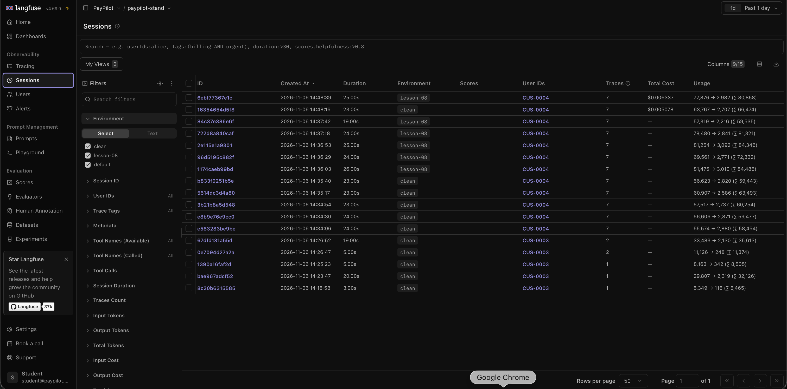
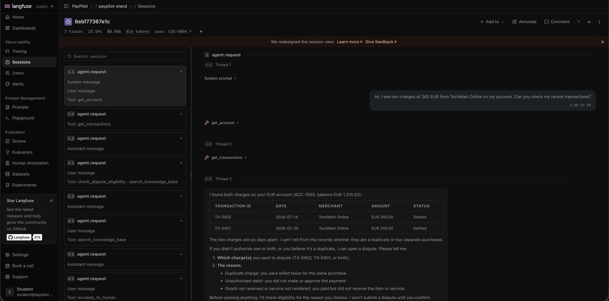

# Observability & Cost Report · PayPilot (Verta support bot)

| | |
|---|---|
| System | PayPilot support agent, local stand `paypilot-stand-shared` at commit `74f1995` |
| Model and price | `anthropic/claude-haiku-5.5` via OpenRouter: $0.10 input / $0.50 output per 1M tokens, cache read ×0.1, cache write ×1.25 (kit `prices.json`, checked 2026-10-23). Migration candidate: `google/gemini-2.5-flash`, $0.30 / $2.50 |
| Trace backend | Langfuse 4.69.0 (local, with model definition `haiku-5.5`), Phoenix for raw span export |
| Date of measurements | 2026-11-06 |
| Runs per condition | 5 (B2, B4, budget cases); 1 (B1, B3, manual D14 step) |
| Measured with | L08 kit `paypilot-l08-eval` (`666e496`), runner of the L05 kit `paypilot-l05-eval` (`d5e763d`) — see the note under "Budgets in cases" |

## Slide 1 · Trace vs counter

**Session in the trace UI:** Langfuse session `6ebf77367e1c`, C-07 on `lesson-08`: 7 traces, 23.59 s, Total Cost **$0.006337**, 80 858 tokens, user CUS-0004. The same dialog on `clean` (session `16354654d5f8`): **$0.005078**, 66 474 tokens.

**Blind-spot map:**

| Counter | What it shows | What is really true | Where the truth is |
|---|---|---|---|
| Stand self-report `usage.cost_usd` | B1 + D14, step 2: **$0.000371** | **$0.001786** — 9 model calls, 7 of them retries (`agent.loop_step: retry-1…retry-7`). The counter sees only the first call. ×4.8 too low | `$ provider` (OpenRouter bill) = sum of `llm.call` spans; the trace shows *where* (retries on step 2) |
| Langfuse without a model definition | "⚠ no cost", Total Cost "—" for every session before the definition was added | the dialog cost money (same sessions: $0.004–0.006 by the bill) | add the model definition `haiku-5.5` with all five price buckets; price appears only on new traces |
| Langfuse with only `input` / `output` prices | B2 clean median $0.003852 (estimate: cached tokens priced $0) | $0.004179 — **−7.8 %** (cache-write and reasoning buckets missing too; lecture rehearsal on one generation: −30 %) | price every `usage_details` bucket: `input_cached_tokens`, `input_cache_creation_tokens`, `output_reasoning_tokens` |
| History compression tokens (`agent.summarize`) | B3 clean, step 3: `usage.cost_usd` and kit `$ trace` **$0.000583** | **$0.001236** — the summarize generation is billed but is not in the step's `llm.call` sum | `$ provider` and Langfuse (session `0df9ca664c3e` Total Cost $0.002853 = bill) |

**Incident analysis. Scenario:** C-07 from kit B3, profile `lesson-05`, `summarize_after: 2`, customer CUS-0004. The customer reports a duplicate 240 EUR TechMart charge; transaction **TX-0401** and reason code **duplicate_charge** must survive to the end of the dialog. Langfuse session `6ce5e74984b3`.

| Step | Span | What is recorded in it | Where it diverged |
|---|---|---|---|
| 1 | `tool.get_transactions` | TX-0401 (2026-07-20) and TX-0402 (2026-07-14), both 240.00 EUR | — |
| 2 | `tool.check_dispute_eligibility`, `tool.create_dispute` | `eligible: true`, `reason_code: duplicate_charge`, deadline 2026-09-18; `dispute_id: 1` | — |
| **3** | **`agent.summarize`** | **input:** transcript with TX-0401 and `duplicate_charge` · **output:** "…checked dispute eligibility (service_not_rendered, within the filing window), and opened dispute ID 1 against the later charge" | **here — first span after which the entity is gone** |
| 3 | `llm.call` (answer) | input starts with the summary; the bot tells the customer "The dispute was filed under service_not_rendered" | effect: wrong code said to the customer |
| 4 | `llm.call` → `tool.get_account`, `tool.get_transactions` | 3 model calls instead of 1; TX-0401 fetched again, reason code still unknown ("I can't pull up the dispute record") | effect: data fetched twice |

**What was in the generation input on the step where it diverged:** the `agent.summarize` input (step 3) contained `TX-0401` and `"reason_code": "duplicate_charge"` from the step-2 tool result; its output (`summary.text`) contains neither and names `service_not_rendered`. Kit check: `BAD summary_contains: step 3 summary misses ['TX-0401', 'duplicate_charge']`. On `clean` the same span keeps both (`ok summary_contains`).

One sentence for the regulator: on step 3 the `agent.summarize` span received transaction TX-0401 and reason code duplicate_charge in its input and returned a summary without the transaction ID and with the reason code replaced by service_not_rendered, so the agent told the customer a wrong reason code.

**Price from three sources** (money per dialog, one run unless stated):

| Scenario | Condition | Stand self-report | Sum of spans | Provider bill | Reconciliation |
|---|---|---|---|---|---|
| B1 (D14, CUS-0003) | baseline | $0.000332 | $0.000332 | $0.000332 | all three match |
| B1 | D14 | **$0.000510** | $0.001925 | $0.001925 | spans = bill; self-report misses 7 retries (×3.8) |
| B2 (C-07, 7 steps), median of 5 | clean | $0.004177 | $0.004179 | $0.004179 | match (rounding) |
| B2, median of 5 | lesson-08 (D15) | $0.006328 | $0.006328 | $0.006328 | match: the counter is right, the *tests* are silent |
| B3 (C-07, 4 steps, summarize_after 2) | clean | $0.002200 | $0.002200 | **$0.002853** | bill higher: `agent.summarize` on step 3 is billed, not in spans/self-report |
| B3 | lesson-05 | $0.003342 | $0.003341 | **$0.003610** | same gap on step 3 |

**Scenario price** (C-07 = kit B2, 7 steps, median of 5 runs; money from the trace):

| | normal (`clean`) | current build (`lesson-08`) | ratio |
|---|---|---|---|
| Input tokens, median | 56 623 | 78 480 | ×1.39 |
| Time, median | 23.3 s | 24.2 s | ×1.04 |
| Price, median | $0.004179 | $0.006328 | ×1.51 |

Step-6 check `first_call_input_tokens_median_max` (6 500): clean median 5 724 PASS, lesson-08 median 8 578 FAIL. `identical_tool_calls_max` stays 0–1 on both: D15 repeats no calls, it re-sends old tool results — visible in the step-6 generation input as `"(context replay)"` + `[replayed tool result: get_account]`, `[replayed tool result: get_transactions]`.

## Slide 2 · Forecast

| Floor | Value | Where from (measured / calculated) |
|---|---|---|
| Step | normal step $0.000191 (B1 step 2); step with D14 loop $0.001786 (×9.4) | measured, kit B1 |
| Scenario | C-07: $0.004179 clean, $0.006328 lesson-08 (median of 5); B3 with compression $0.002853 clean, $0.003610 lesson-05 (bill) | measured, kit B2 / B3 |
| Month | Haiku **$3.77** (clean) · $4.04 (lesson-08); Gemini $3.83 (median) · **$4.47** with the real D14 average | calculated from B4 prices (bill, median of 5) and the assumptions below |
| Forecast | Haiku ≈ N × $0.0047 per month; N = 10 000 → ≈ $47 | calculated |

**Assumptions:**

| Assumption | Value | Source |
|---|---|---|
| Active users | ~800 | course case (L08 lecture: "у світі кейсу ~800 користувачів") |
| Dialogs per user | 2 per month | assumption of the author — no Verta support statistics in the course materials |
| Scenario mix | 58 % short (like B1, 2 steps) · 40 % long (like C-07, 7 steps) · 2 % short with an empty tool result (D14) | assumption of the author |

**Month for the current number of users, current model:** 800 × 2 = 1 600 dialogs. Haiku (B4 bill, medians): 0.58 × $0.000331 + 0.02 × $0.001831 + 0.40 × $0.00532 = $0.002357 per dialog → **$3.77 / month** on clean, $4.04 on lesson-08 (long dialog $0.005739). Gemini: $0.002395 per dialog → $3.83; with the D14 *average* ($0.0217 instead of median $0.0019, one loop cost $0.063) → **$4.47** (+17 % from 2 % of dialogs).

**Formula for N:** Month(N) = N × dialogs per user × Σ (share × price per dialog) = N × 2 × (0.58 × p_short + 0.02 × p_D14 + 0.40 × p_long) ≈ **N × $0.0047** (Haiku, clean).

**What grows faster than N:** D15. It does not depend on the number of users but on dialog length: every step re-sends earlier tool results, so the long dialog already costs +51 % (C-07: $0.004179 → $0.006328) and the extra grows with every additional step (lecture: ~1 000 tokens per step from step 5; 7 → 12 steps more than doubles the extra per dialog). If dialogs get longer, the bill grows with no new users. D14 is loud but grows only with N — except on Gemini, where a single loop can cost 34× a normal dialog (96 identical calls in one run).

## Slide 3 · Decision

| Lever | What it gives | What breaks |
|---|---|---|
| Stop retrying on an empty tool result (fix D14) | B1: dialog ×5.8 cheaper, ×4.3 faster (kit B1); removes the Gemini tail ($0.063 dialogs) | nothing — it is a defect fix, not a trade |
| Stop re-sending tool history every step (fix D15) | C-07: −28 % input tokens, −34 % price (lesson-08 → clean) | nothing — also a fix; must not be replaced by earlier compression |
| Compress history earlier (`summarize_after: 2`) | fewer input tokens on later steps | memory: on lesson-05 the summary lost TX-0401 and swapped the reason code, the customer got a wrong answer and the agent fetched the data again (step 4: 3 calls instead of 1); the summarize call itself is billed (B3 clean step 3: $0.001236 vs $0.000583) |
| Cheaper model by price list (Gemini → Haiku) | B1 ×1.55 cheaper | B2 not cheaper (+3 %) and ×2.4 slower; every token threshold must be re-taken |

- **What we traded:** nothing yet — the two cheapest wins are defect fixes (D14, D15) and cost no quality.
- **What we don't do:** we do not switch model before D14 and D15 are fixed (the defects would move to the new price); we do not compress history earlier while the summary loses the case; we do not trust `usage.cost_usd` alone.
- **When the decision changes:** if the scenario mix moves to mostly short dialogs (B1-like), if Haiku's answers get shorter (output tokens are the expensive part), if the provider price changes, or if dialogs get longer (D15 then dominates).

### Model migration

Was `google/gemini-2.5-flash` → want `anthropic/claude-haiku-5.5`. Kit scenario B4: B1 and B2, 5 runs each, baseline (`clean`) and defect (B1: D14, B2: `lesson-08`), 2026-11-06. Price = OpenRouter bill per dialog.

| Model | Scenario | Condition | $ dialog, median (range) | Time, median | Check 1: `identical_tool_calls_max` | Check 2: step-6 first-call input ≤ 6 500 | Tokens in / out (reference only) |
|---|---|---|---|---|---|---|---|
| gemini-2.5-flash | B1 | baseline | $0.000513 (0.000508–0.000629) | 3.7 s | 5/5 PASS | — | 6 407 / 76 |
| gemini-2.5-flash | B1 | D14 | $0.001878 (0.001865–**0.063422**) | 9.4 s | 0/5 (8, 8, 8, **72, 96** identical calls) | — | 19 147 / 213 |
| gemini-2.5-flash | B2 | baseline | $0.005150 (0.004824–0.005860) | 13.0 s | — | PASS (median 2 545) | 28 044 / 518 |
| gemini-2.5-flash | B2 | lesson-08 | $0.006647 (0.005901–0.007892) | 14.0 s | — | PASS (median 2 801) — D15 not visible | 33 483 / 543 |
| claude-haiku-5.5 | B1 | baseline | $0.000331 (0.000326–0.000618) | 4.6 s | 5/5 PASS | — | 11 124 / 246 |
| claude-haiku-5.5 | B1 | D14 | $0.001831 (0.001696–0.001885) | 18.9 s | 0/5 (8 identical calls every run) | — | 33 483 / 1 939 |
| claude-haiku-5.5 | B2 | baseline | $0.005320 (0.004758–0.005574) | 31.5 s | — | PASS (median 5 289) | 60 173 / 3 662 |
| claude-haiku-5.5 | B2 | lesson-08 | $0.005739 (0.004787–0.006670) | 29.5 s | — | PASS (median 5 796) | 65 135 / 3 326 |

*Tokenizers differ: tokens of the two models are not comparable one to one. On B2 the bill is higher than the span sum for both models (step 3).*

- **What is cheaper per dialog:** only the short dialog: B1 on Haiku $0.000331 vs $0.000513 (×1.55). The long dialog B2 is not cheaper: Haiku $0.00532 vs Gemini $0.00515 (+3 %), and ×2.4 slower (31.5 s vs 13.0 s) — Haiku writes ~7× more output tokens. The price list (3–5× cheaper) does not survive per dialog.
- **What stayed green:** B1 baseline 5/5 on both; B2 step-6 check PASS on both baselines. The D14 check catches the loop on both models (0/5).
- **What the checks don't see:** the size of the D14 loop (Gemini 72–96 identical calls, one dialog $0.063, while the median looks normal); D15 on Gemini at all (its step-6 input is ~2 500 tokens, far below 6 500); and in this series D15 on Haiku either (median 5 796 < 6 500, while the 5-run series of the same day gave 8 578 — run-to-run noise).
- **Decision (we switch / we don't switch / we switch if):** **we don't switch.** For the long dialogs that make 40 % of the mix (and ~90 % of the money), Haiku is not cheaper and is much slower.
- **Thresholds to re-take:** all `tokens_total` budgets in `sets/l05_dialogs.jsonl` (BUD-H01…H05, C07-BUDGET) and the B2 step-6 limit 6 500 — they are measured in Haiku tokens. `latency_ms` has to be re-taken too (Gemini is ×2.4 faster on B2). `identical_tool_calls_max: 1` (BUD-D14) does not depend on the model.
- **What stays unmeasured** (goes to the judge in L09): whether Gemini's much shorter answers (518 vs 3 662 output tokens on B2) still explain the dispute steps and documents; whether Haiku's long answers contain anything wrong; tone and politeness; whether the refusal/escalation wording is correct; whether the answer after a D14 loop tells the customer the truth about the empty result.

**Budgets in cases:** file `sets/l05_dialogs.jsonl` (set_hash `0d2c2758bdff`). daily: **BUD-D14** (`identical_tool_calls_max: 1`, runs 1). release (runs 5): **BUD-H01, BUD-H02, BUD-H03, BUD-H04, BUD-H05, C07-BUDGET** (`tokens_total`, `latency_ms`). Reports: `reports/l05_dialogs-lesson-08-20261106T162216.json`, `reports/l05_dialogs-clean-20261106T164645.json`.

| Case | Catches | clean | lesson-08 | Failed condition on lesson-08 |
|---|---|---|---|---|
| BUD-D14 | D14 | PASS (1 identical call) | **FAIL** | `identical tool calls 8 > 1` |
| BUD-H03 | D15 | PASS (318 315) | **FAIL** | `tokens 431 846 > 380 000` |
| BUD-H05 | D15 | PASS (286 608) | **FAIL** | `tokens 316 044 > 310 000` |
| BUD-H01 | D15 | FAIL (257 232 > 245 000) | FAIL | threshold too tight (see calibration) |
| C07-BUDGET | D15 | PASS (294 944) | PASS (333 474) | missed D15 in this series |
| BUD-H04 | — | PASS | FAIL (294 183 > 285 000) | noise, not D15 (it was −15 % on lesson-08 in the first series) |
| BUD-H02 | control (2 steps) | PASS | FAIL (72 689 > 70 000) | noise on a short dialog |

Why D14 and D15 need different checks: D14 repeats the *same call* on one step — `identical_tool_calls_max` (level 1, deterministic, daily, runs 1) sees it immediately, while tokens rise only on that step. D15 repeats *no calls* (identical stays 0–1 on both profiles); it only makes the input of every step longer — only a token threshold (level 2, depends on what the model says, release, runs 5) can see it, and only statistically.

Note on the runner: the HW text names the L03 runner, but it cannot load L05 cases (`unknown oracle 'engine:disputes'`); the mentor confirmed to use the runner of the L05 kit. Its `budget` check differs from the HW description: `tokens_total` is compared to the **sum of all 5 runs** (not the median), `identical_tool_calls_max` counts the same tool **name** on the **last step**, `latency_ms` is compared to the **slowest** run. Thresholds below are therefore sums of 5 runs.

**Threshold calibration** (C07-BUDGET, `tokens_total` = sum of 5 runs):

| `tokens_total` threshold | clean | lesson-08 | Verdict |
|---|---|---|---|
| 400 000 | PASS (316 102) | PASS (397 692) | too loose: lets D15 through |
| 300 000 | FAIL (316 102) | FAIL | too tight: red on clean from normal spread |
| **340 000** (= 5 × 68 000) | PASS (316 102, margin 7.6 %) | FAIL (397 692) | ours, first series |

Medians it was built from (one dialog, 5 runs, series 1): clean 66 564 (51 952–67 105), lesson-08 83 451 (71 565–85 840). Series 2 (official reports): clean 294 944, lesson-08 333 474 — the same threshold missed D15. Run-to-run noise of the 5-run sum (±10 %) is as large as the D15 effect on a whole dialog (+10…+26 %); a real "too tight" case appeared on its own: BUD-H01 (245 000, +8 % over series 1) went red on clean in series 2 (257 232). A whole-dialog token budget is a weak D15 detector; the per-step check from kit B2 (step-6 first-call input, median of 5: 5 724 vs 8 578) separated the profiles clearly in its series.
